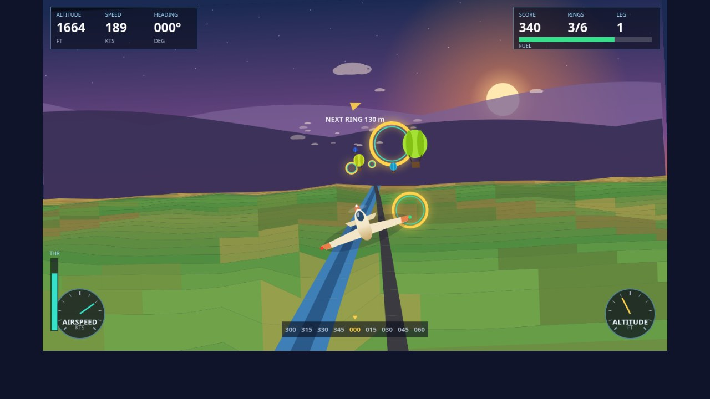
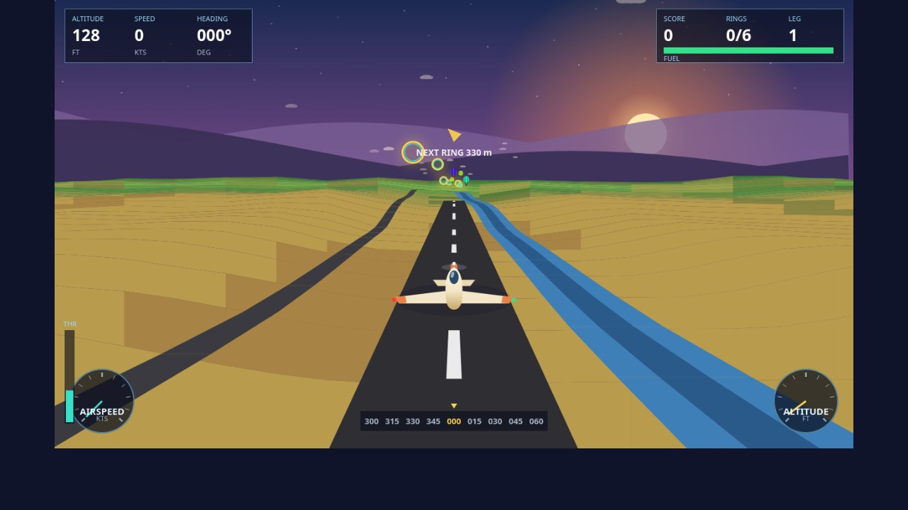
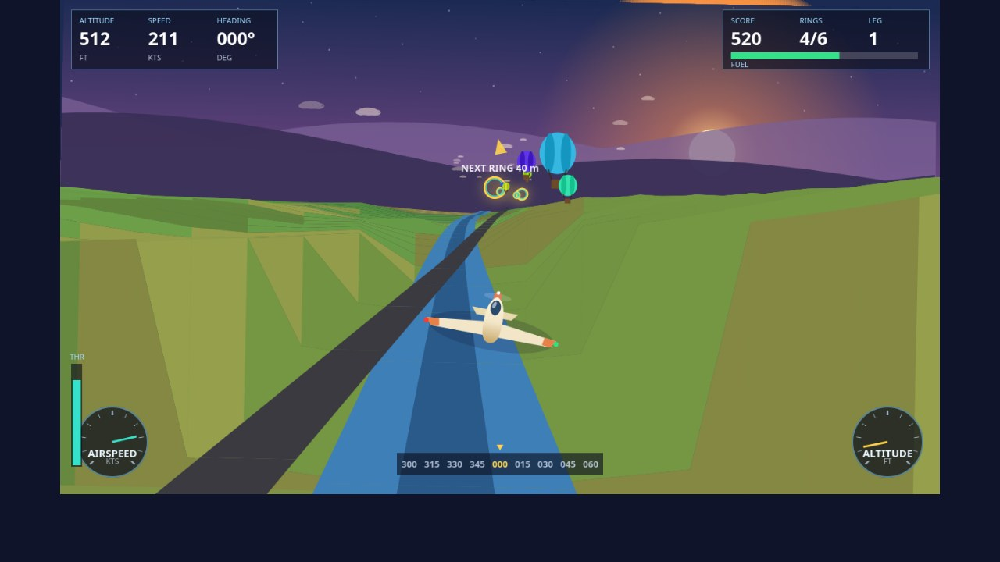
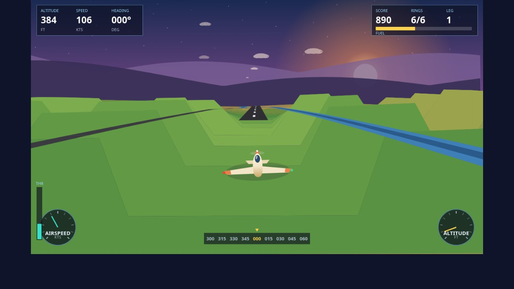

# Aurora Courier

[](https://make.fun/bounty/best-flight-game-20261126-0057)
[](https://make.fun/bounty/best-flight-game-20261126-0057/leaderboard)
[](https://make.fun/bounty/best-flight-game-20261126-0057)

A golden-hour parcel run: fly the rings, mind your fuel, land the leg.
Built for the [Make the best flight game](https://make.fun/bounty/best-flight-game-20261126-0057) bounty.

## Play

Open `game/index.html` in a desktop browser — no build step, no network,
everything runs from local files. Or serve it:

```sh
node serve.ts        # then open http://localhost:8080
```

- **Arrows / WASD** — steer (bank to turn, pitch to climb and dive)
- **Shift / Ctrl** — throttle up / down
- **Space** — boost (burns fuel faster)
- **Mouse** — steer by pointer
- **Enter** — start · **R** — fly again

Each leg: take off from the runway, fly through six glowing rings
(+100 points and +14 fuel each), dodge the drifting balloons, and put her
down on the runway before the fuel runs out. A smooth landing pays +500 and
+40 fuel, and the next leg is faster, higher and tighter. Hit the ground,
a balloon too hard, or run dry and the run is over — best score is kept.

## What is in here

- `game/` — the game itself, plain HTML and Canvas 2D, no dependencies.
  `src/` splits the work by job: `config.js` (tuning), `random.js` (seeded
  noise), `input.js` (keyboard and mouse), `world.js` (valley, river, road,
  runway, rings, balloons), `physics.js` (the flight model), `render.js`
  (pseudo-3D chase view, sky, HUD), `shots.js` (deterministic screenshot
  scenes), `main.js` (loop and states).
- `screenshots/` — four real renders of the game running in a browser.
- `shots.json` — the four screenshot scenes (`?shot=…&seed=7`).
- `main.ts` — the hand-in program: copies `game/` and `screenshots/` to
  `/output` and writes `dossier.json` with the kit's vendored library.
- `serve.ts` — a small static server for local play.
- `vendor/makefun-game.ts` — the kit's library, byte for byte as shipped.

## Screenshots

| | |
| --- | --- |
|  |  |
|  |  |

## License

MIT — see [LICENSE](LICENSE).
